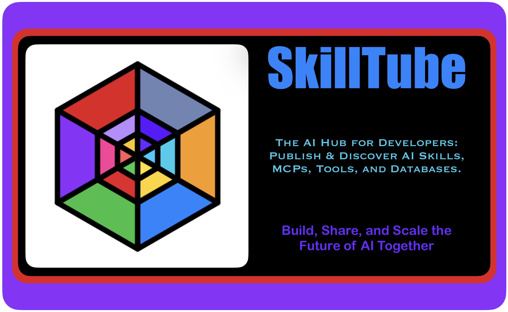
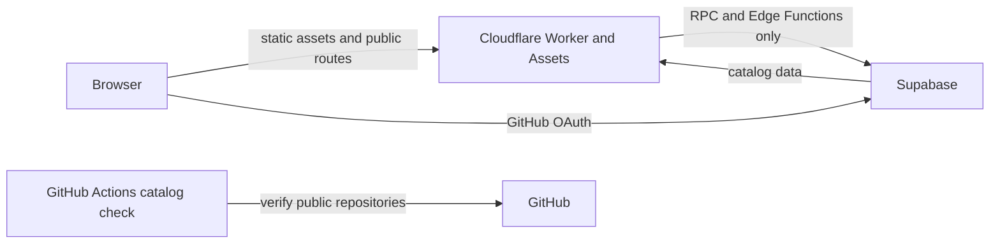

<div align="center">


# SkillTube

### Discover and share AI skills and the tools around them.

[](LICENSE)
[](https://workers.cloudflare.com/)
[](https://supabase.com/)
[](https://skilltube.ayushgiri-ai-21.workers.dev/)



</div>

SkillTube is a free, open directory for **AI skills first**, plus MCP servers,
datasets, databases, prompts, agents, guides and other AI tools. Developers
keep their projects in public GitHub repositories; SkillTube adds structured
discovery, useful tags, public developer channels and community signals.

## Features

- Search AI resources by name, description and structured topics.
- Browse server-rendered skill and developer pages, with Markdown alternatives
  for crawlers and assistants.
- Sign in with GitHub to publish, manage and share listings.
- Follow developers, star listings, discuss work and receive update indicators.
- Discover badges, weekly rankings and developer channels.
- Report content through a documented review and response flow.
- Use a responsive interface designed for keyboard, touch and small screens.

## Architecture



The browser does not read database tables. It calls only the functions exposed
by the backend through [`public/js/api.js`](public/js/api.js). Public skill and
developer pages are rendered by the Worker; the app shell and static content
are served from `public/`.

## Technology

| Area | Technology |
| --- | --- |
| Web app and static content | HTML, CSS and native JavaScript modules |
| Hosting and server-rendered public pages | Cloudflare Workers and Assets |
| Authentication and data | Supabase Auth, Postgres, RPC and Edge Functions |
| Repository ownership checks | GitHub OAuth and GitHub API |
| Periodic catalog check | GitHub Actions |

## Security and privacy

- Browser code calls backend functions; it never queries Supabase tables.
- Authorization and input validation are enforced by SQL/RLS and Edge Functions.
- The browser contains only the publishable Supabase key; server secrets stay
  in the deployment environment.
- Markdown rendered into HTML is sanitized with the vendored DOMPurify.
- SkillTube does not store IP addresses, run analytics or use tracking cookies.
- Each listing remains in its developer's repository; read the repository's
  license before using its contents.

Read the [documentation index](docs/README.md), [security model](docs/SECURITY_MODEL.md), [architecture](docs/ARCHITECTURE.md),
[error-code guide](docs/ERROR_CODES.md) and
[security reporting policy](https://github.com/Let-s-Code-India/.github/blob/main/SECURITY.md).

## Live site

- [SkillTube](https://skilltube.ayushgiri-ai-21.workers.dev/)
- [Developers](https://skilltube.ayushgiri-ai-21.workers.dev/developers/)
- [Leaderboard](https://skilltube.ayushgiri-ai-21.workers.dev/leaderboard/)
- [Badges](https://skilltube.ayushgiri-ai-21.workers.dev/badges/)
- [FAQ](https://skilltube.ayushgiri-ai-21.workers.dev/faq/)
- [Documentation hub](https://skilltube.ayushgiri-ai-21.workers.dev/docs/)
- [Privacy](https://skilltube.ayushgiri-ai-21.workers.dev/legal/privacy/)
- [robots.txt](https://skilltube.ayushgiri-ai-21.workers.dev/robots.txt)
- [Sitemap](https://skilltube.ayushgiri-ai-21.workers.dev/sitemap.xml)
- [llms.txt](https://skilltube.ayushgiri-ai-21.workers.dev/llms.txt)

## Local development

The website has no frontend bundler or site build step. Open this repository in
Codespaces, edit files under `public/` or `worker/`, and use the repository's
Cloudflare Workers Builds deployment for the live service. For local checks:

```sh
npm ci
npm run check:posts
npm run check:schema
npm run check:links
npm run check:worker
npm run check:security
node tools/stamp-footer.mjs --check
node tools/check-public-location.mjs
```

The post generator runs at commit time and writes static HTML; visitors do not
fetch Markdown at runtime. Run `npm run generate:posts` after changing post
sources or metadata.

## Catalog

The scheduled GitHub Actions catalog workflow rechecks listed public GitHub
repositories every six hours. It removes unavailable listings only according
to the backend's retry and deletion rules. The workflow needs the repository's
Supabase URL and service-role secret; never put those secrets in source files.
See the [runbook](docs/RUNBOOK.md).

## Project layout

```text
public/                  App, static pages, styles, images and vendored browser libraries
  js/pages/              One module per app route
  js/components/         Reusable interface components
  legal/                 Public policy pages
  why-skilltube/         Generated blog index and static articles
content/why/             Markdown sources for the blog
worker/                  Public server-rendered routes and sitemap
catalog/                 Scheduled repository verification
schema/                  Public content schemas and fixtures
docs/                    Architecture, security and operations docs
licenses/                Project and third-party license notices
tools/                   Static-content and acceptance-check scripts
```

## Contributing

Issues and pull requests are welcome. Please follow the organization-level
[contribution guide](https://github.com/Let-s-Code-India/.github/blob/main/CONTRIBUTING.md)
and [Code of Conduct](https://github.com/Let-s-Code-India/.github/blob/main/CODE_OF_CONDUCT.md).
The source code is under the [MIT License](LICENSE); listed resources remain
under their own authors' licenses. SkillTube name and artwork use the
[brand guidelines](licenses/BRAND.md).

## Contact

- ayushgiri.ai.21@gmail.com
- ayushgiri.25@icloud.com
- ayushgiri.dev1@outlook.com

Created by Ayush Giri, Founder of Let's Code India.
